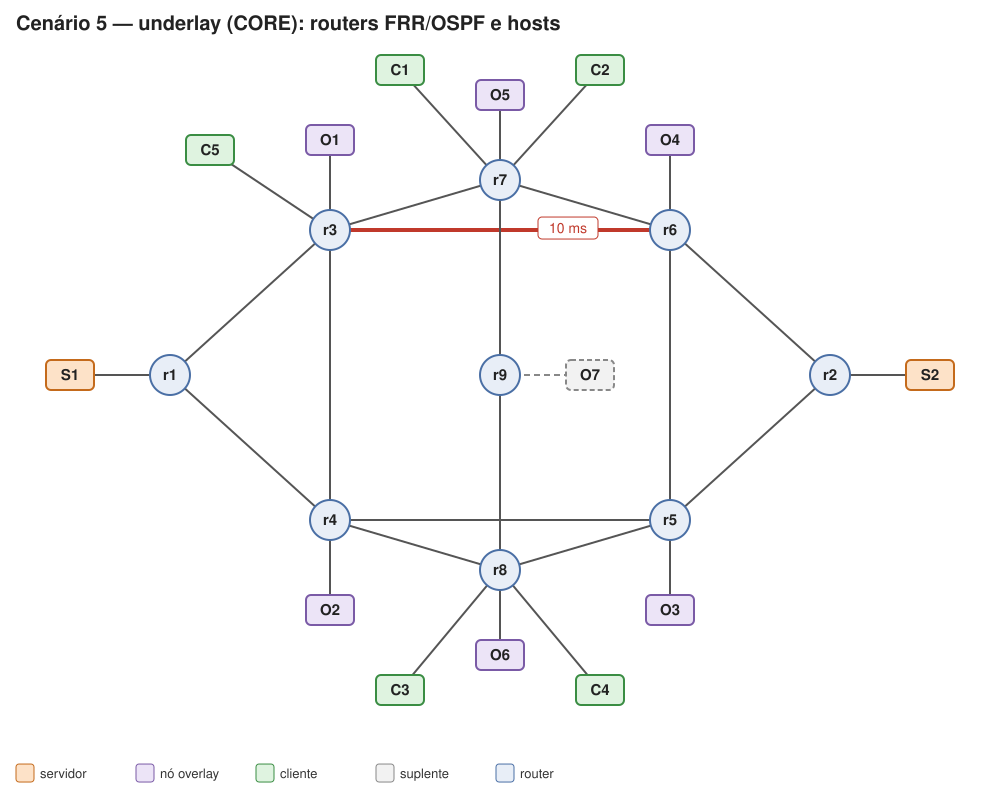
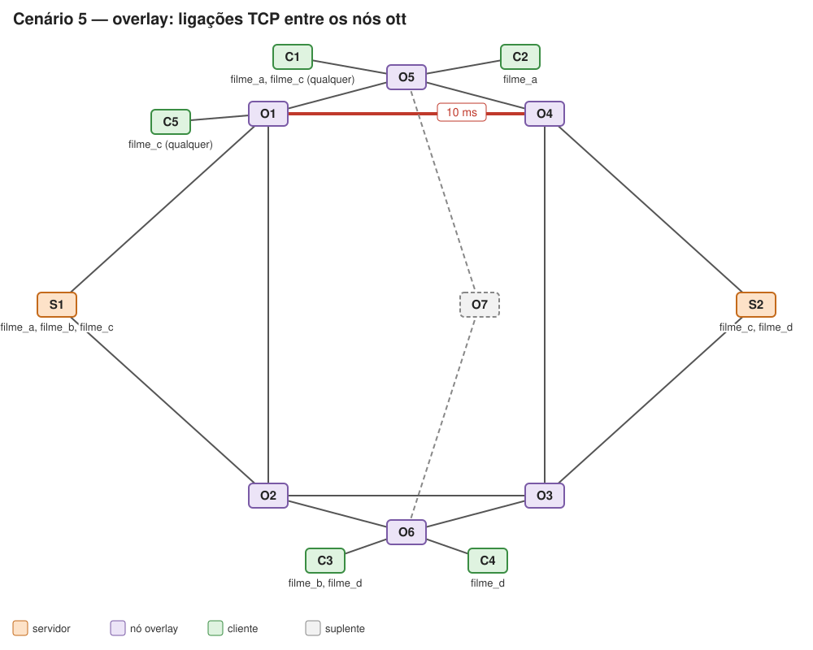

# Cenário 5: dois servidores num anel com acessos

> Criado em 2026-11-18 para testar **todos os requisitos mínimos** do enunciado num só cenário, com uma topologia fácil de
> ler. O `filme_c` é publicado pelos dois servidores e o C1 e o C5 subscrevem-no **sem servidor fixo** (D38): cada um usa
> o servidor mais perto e passa para o outro se esse deixar de ter caminho. Ficheiros: `topologies/cenario5.xml` (CORE), `topologies/cenario5.json` (overlay), `topologies/cenario5.plano.json`
> (o que corre em cada nó, para o `ottctl`) e `topologies/gerar_cenario5.py` (gera os três; para mudar a topologia edita as
> tabelas do programa e volta a corrê-lo). Coerência testada em `tests/test_topologias.py` (`Scenario5Test`). Ensaiado só
> em localhost (nós reais, `ottctl --backend local`); **ainda não foi aberto no CORE**.

## 1. Topologia

### 1.1 Underlay (o que se abre no CORE)

Routers FRR/OSPF (círculos) e hosts (retângulos) nas mesmas posições do desenho do CORE. Cada host liga-se a um router por
uma sub-rede `/24` própria. A única ligação com atraso de base é a r3–r6 (10 ms, a vermelho).



### 1.2 Overlay (as ligações TCP entre os `ott`)

Cada linha é uma ligação overlay; corre sobre o caminho IP host – router – router – host da figura anterior. Por baixo de
cada servidor estão os fluxos que publica e por baixo de cada cliente os que subscreve. O O7 (tracejado) só arranca no
ensaio 9.



Os dois desenhos são gerados por `topologies/gerar_cenario5.py` (`docs/img/cenario5-underlay.svg` e
`docs/img/cenario5-overlay.svg`), por isso acompanham as alterações da topologia.

Caminhos esperados no CORE (métrica: latência acumulada; os 10 ms afastam o tráfego da O1–O4):

| Fluxo | Cliente(s) | Caminho |
|---|---|---|
| `S1:filme_a` | C1, C2 | S1 → O1 → O5 → C1, C2 (uma só cópia até ao O5) |
| `S1:filme_b` | C3 | S1 → O2 → O6 → C3 |
| `filme_c` (qualquer) | C5 | do **S1**, o mais perto: S1 → O1 → C5 |
| `filme_c` (qualquer) | C1 | do S1 (S1 → O1 → O5) ou do S2 (S2 → O4 → O5): 2 saltos sem atraso nos dois, ganha o de menor RTT |
| `S2:filme_d` | C3, C4 | S2 → O3 → O6 → C3, C4 (uma só cópia até ao O6) |
| `filme_c` sem o S1 (ensaio 8) | C5 | S2 → O3 → O2 → O1 → C5 (4 saltos, evita os 10 ms do O4 → O1) |

**Overlay** (14 nós, o id overlay é igual ao nome do nó no CORE):

| Nó | Papel | Vizinhos overlay | Host (IP) | Router |
|---|---|---|---|---|
| S1 | servidor (`filme_a`, `filme_b`, `filme_c`) e bootstrapper | O1, O2 | 10.0.14.20 | r1 |
| S2 | servidor (`filme_c`, `filme_d`) e bootstrapper | O3, O4 | 10.0.15.20 | r2 |
| O1 | anel | S1, O2, O4, O5, C5 | 10.0.16.20 | r3 |
| O2 | anel | S1, O1, O3, O6 | 10.0.17.20 | r4 |
| O3 | anel | S2, O2, O4, O6 | 10.0.18.20 | r5 |
| O4 | anel | S2, O1, O3, O5 | 10.0.19.20 | r6 |
| O5 | acesso de cima | O1, O4, O7, C1, C2 | 10.0.20.20 | r7 |
| O6 | acesso de baixo | O2, O3, O7, C3, C4 | 10.0.21.20 | r8 |
| O7 | **suplente** (só arranca no ensaio 9) | O5, O6 | 10.0.22.20 | r9 |
| C1 | cliente `S1:filme_a` e `filme_c` (qualquer servidor) | O5 | 10.0.23.20 | r7 |
| C2 | cliente `S1:filme_a` | O5 | 10.0.24.20 | r7 |
| C3 | cliente `S1:filme_b` e `S2:filme_d` | O6 | 10.0.25.20 | r8 |
| C4 | cliente `S2:filme_d` | O6 | 10.0.26.20 | r8 |
| C5 | cliente `filme_c` (qualquer servidor) | O1 | 10.0.27.20 | r3 |

**Underlay** (9 routers FRR/OSPF, um por nó de infraestrutura): cada ligação overlay entre nós de infraestrutura é uma
ligação direta entre os seus routers, por isso o caminho IP de cada ligação overlay é único (host – router – router – host)
e o OSPF não reparte tráfego por caminhos de custo igual (o problema da teia do cenário 4). Os clientes ficam em sub-redes
próprias no router do seu nó de acesso. **A ligação r3–r6 (O1–O4) tem 10 ms de atraso de base**; todas as outras têm 0.

Interfaces dos routers (para `tc` e `ip link`):

| Router | eth0 | eth1 | eth2 | eth3 | eth4 | eth5 |
|---|---|---|---|---|---|---|
| r1 (S1) | r3 (O1) | r4 (O2) | S1 | | | |
| r2 (S2) | r5 (O3) | r6 (O4) | S2 | | | |
| r3 (O1) | r1 (S1) | r4 (O2) | r6 (O4), **10 ms** | r7 (O5) | O1 | C5 |
| r4 (O2) | r1 (S1) | r3 (O1) | r5 (O3) | r8 (O6) | O2 | |
| r5 (O3) | r2 (S2) | r4 (O2) | r6 (O4) | r8 (O6) | O3 | |
| r6 (O4) | r2 (S2) | r5 (O3) | r3 (O1), **10 ms** | r7 (O5) | O4 | |
| r7 (O5) | r3 (O1) | r6 (O4) | r9 (O7) | O5 | C1 | C2 |
| r8 (O6) | r4 (O2) | r5 (O3) | r9 (O7) | O6 | C3 | C4 |
| r9 (O7) | r7 (O5) | r8 (O6) | O7 | | | |

Não aplicar `tc` à r3–r6: o CORE já lá tem um `netem` (os 10 ms) e um `tc qdisc del` apagava-o.

## 2. Requisitos mínimos e onde se testam

| Requisito do enunciado | Ensaio |
|---|---|
| Nó overlay é um programa executado à mão | todos (um `ott` por nó) |
| Nós criados e destruídos dinamicamente | 4, 6, 7, 8 e 9 (saídas e reentradas; o O7 entra a meio) |
| Ligações com X vizinhos | 1 (vizinhos iguais aos do JSON) e 9 (o O7 junta-se ao O5 e ao O6) |
| Conhecer um nó para obter os vizinhos | todos (`-b 10.0.14.20`); o S2 é bootstrapper de si próprio |
| Tabela de rotas por fluxo (Fluxo, Custo, Origem, Destinos, Estado) | 1 e 6 (rotas inativas sem clientes; painel → *Rotas*) |
| Rotas alternativas e vários clientes em simultâneo | 1 (5 clientes, 4 fluxos), 3, 4 e 5 (caminhos alternativos) |
| Monitorização e atualização dinâmica das rotas | 3 (atraso), 4 (queda de nó), 5 (link em baixo), 7, 8 e 9 |
| Reenvio dos dados de acordo com a tabela | 1 (uma só cópia do `filme_a` no troço O1→O5 para o C1 e o C2) |
| Dois servidores com dois fluxos distintos cada | 1 (os 5 fluxos), 7 e 8 (queda de um servidor não afeta os fluxos do outro) |
| Métricas da rede na construção das rotas | 2 (escolha do servidor mais perto), 3 e 8 (o `filme_c` chega ao C5 por 4 saltos rápidos, não por 3 com 10 ms) |
| (extra, D38) mesmo fluxo em dois servidores | 2 (escolha), 7 e 8 (o cliente passa para o outro servidor) |

## 3. Lançar

Abrir `topologies/cenario5.xml` no `core-gui` e fazer *Start*; esperar ≈ 30 s pelo OSPF e confirmar a partir de um cliente
com `ping -c 3 10.0.14.20`. Duas formas de arrancar os nós:

- **À mão** (para ensaios com logs a analisar): os comandos da secção 4, um em cada nó do CORE. Logs em
  `ott-logs/cenario5/AAAA-MM-DD-K/`; ao repetir a sessão no mesmo dia, trocar o `-1` por `-2`, `-3`, … em todos os nós.
- **Pelo painel** (para ver a topologia e para a apresentação): no anfitrião, `sudo make dashboard CEN=cenario5`, abrir
  `http://127.0.0.1:8080` e **Lançar tudo** (o O7 fica por lançar: é o suplente). No separador *Vídeo*, os mosaicos
  `filme_c` do C1 e do C5 dizem de que servidor vem o vídeo (`de S1`). Logs em `/tmp/ottctl/cenario5/`.
  Não misturar as duas formas na mesma sessão (só um `ott` por nó).

## 4. Comandos por nó (à mão)

Os servidores primeiro. Cada linha já faz `cd` para a pasta do projeto.

```sh
# S1 — servidor e bootstrapper
cd /home/luis/uni/esr/tp2/ESR26-27 && ./bin/ott --serve topologies/cenario5.json -i S1 --publish-flow filme_a --publish-flow filme_b --publish-flow filme_c --live --log-traffic --log-dir /home/luis/uni/esr/tp2/ott-logs/cenario5/$(date +%F)-1

# S2 — servidor e bootstrapper de si próprio (não depende do S1)
cd /home/luis/uni/esr/tp2/ESR26-27 && ./bin/ott --serve topologies/cenario5.json -i S2 --publish-flow filme_c --publish-flow filme_d --live --log-traffic --log-dir /home/luis/uni/esr/tp2/ott-logs/cenario5/$(date +%F)-1

# O1, O2, O3, O4, O5, O6 — trocar ID pelo nó (O7 só no ensaio 9)
cd /home/luis/uni/esr/tp2/ESR26-27 && ./bin/ott -i ID -b 10.0.14.20 --live --log-traffic --log-dir /home/luis/uni/esr/tp2/ott-logs/cenario5/$(date +%F)-1

# C1
cd /home/luis/uni/esr/tp2/ESR26-27 && ./bin/ott -i C1 -b 10.0.14.20 --subscribe S1:filme_a --subscribe filme_c --live --log-traffic --log-dir /home/luis/uni/esr/tp2/ott-logs/cenario5/$(date +%F)-1

# C2
cd /home/luis/uni/esr/tp2/ESR26-27 && ./bin/ott -i C2 -b 10.0.14.20 --subscribe S1:filme_a --live --log-traffic --log-dir /home/luis/uni/esr/tp2/ott-logs/cenario5/$(date +%F)-1

# C3
cd /home/luis/uni/esr/tp2/ESR26-27 && ./bin/ott -i C3 -b 10.0.14.20 --subscribe S1:filme_b --subscribe S2:filme_d --live --log-traffic --log-dir /home/luis/uni/esr/tp2/ott-logs/cenario5/$(date +%F)-1

# C4
cd /home/luis/uni/esr/tp2/ESR26-27 && ./bin/ott -i C4 -b 10.0.14.20 --subscribe S2:filme_d --live --log-traffic --log-dir /home/luis/uni/esr/tp2/ott-logs/cenario5/$(date +%F)-1

# C5
cd /home/luis/uni/esr/tp2/ESR26-27 && ./bin/ott -i C5 -b 10.0.14.20 --subscribe filme_c --live --log-traffic --log-dir /home/luis/uni/esr/tp2/ott-logs/cenario5/$(date +%F)-1
```

Registar cada ação em `acoes.txt`, na mesma linha de comando (o `echo` pode correr em qualquer terminal, mesmo no
anfitrião; a pasta tem de existir, por isso arrancar primeiro um nó):

```sh
echo "$(date +%T.%N) ensaio N: descrição" >> /home/luis/uni/esr/tp2/ott-logs/cenario5/$(date +%F)-1/acoes.txt
```

As ações nos routers (`tc`, `ip link`, `tcpdump`) correm num **segundo terminal** desse router (duplo clique no nó).

## 5. Ensaios (por esta ordem, na mesma sessão)

### 1. Arranque, dois servidores e ramos partilhados
Arrancar todos menos o O7; esperar 60 s.
- Cada nó liga-se exatamente aos vizinhos da tabela da secção 1.
- Os 5 clientes recebem os seus fluxos a 20/s (5 fluxos, de dois servidores; o `filme_c` existe nos dois).
- Uma só cópia do `filme_a` no troço O1→O5, apesar de o C1 e o C2 o receberem; no **r7**:
  `timeout 10 tcpdump -ni eth0 -q udp port 6000 2>/dev/null | wc -l` → ≈ 200 (um fluxo a 20/s).
- Tabela de rotas: no painel (*Rotas*) ou no bloco `--live`; o S1 e o S2 mostram cada fluxo `ativo` com os seus destinos.

### 2. Réplica: cada cliente escolhe o servidor mais perto
Só observar. No log do **C5**: `subscrito a filme_c: escolhido o servidor S1` (S1 → O1 → C5, 2 saltos, contra 4 até ao
S2). No **C1**: o servidor escolhido para o `filme_c` (S1 ou S2: os dois a 2 saltos sem atraso; ganha o de menor RTT). No
bloco `--live` de cada um, o `filme_c` aparece com o servidor em uso (`S1:filme_c` ou `S2:filme_c`). Só esse servidor emite
o `filme_c` para esse cliente: o outro não lhe abre ramo.

### 3. Atraso no caminho ativo (alterações nas condições da rede)
No **r3**, ligação para o O5 (por onde o O5 recebe o `filme_a`):
```sh
echo "$(date +%T.%N) ensaio 3: netem 20ms r3 eth3" >> /home/luis/uni/esr/tp2/ott-logs/cenario5/$(date +%F)-1/acoes.txt; tc qdisc add dev eth3 root netem delay 20ms
```
Esperar 60 s; remover com `tc qdisc del dev eth3 root` (e registar). Esperado: o O5 passa o `filme_a` para o O4
(S1–O2–O3–O4–O5) **uma só vez**, sem perdas no C1 e no C2 além da troca. Sem o atraso, o O5 **fica no O4** (o ganho de
voltar ao O1 é menor do que a histerese de 1 ms), como no ensaio 8 do cenário 3.

### 4. Queda de um nó intermédio
Ctrl-C no **O2** (por onde o O6 recebe o `filme_b`); esperar 30 s; relançar; esperar 60 s.
Esperado: o O6 passa o `filme_b` para o O3. Se a alternativa for viável, repara sem `WITHDRAW` (falha ≤ 1 imagem no C3);
se não for (o O3 anunciava mais do que o O6), o O6 retira e reaprende na ronda seguinte (C3 sem vídeo ≤ 5 s). Os outros
clientes não são afetados. Com o O2 de volta, o O6 regressa a ele.

### 5. Ligação do underlay em baixo
No **r7**, ligação para o r6 (por onde o O5 recebe o `filme_a` depois do ensaio 3, e o `filme_c` se o C1 o recebe do S2):
```sh
echo "$(date +%T.%N) ensaio 5: eth1 down no r7" >> /home/luis/uni/esr/tp2/ott-logs/cenario5/$(date +%F)-1/acoes.txt; ip link set eth1 down
```
Esperar 60 s; repor com `ip link set eth1 up` (e registar); esperar 60 s.
Esperado: aqui o overlay corre sobre IP com rotas, por isso há duas possibilidades, e as duas mostram o requisito:
- o OSPF (*dead interval* 6 s) recalcula o caminho r7–r6 por r3 (com a ligação de 10 ms) antes de o PING desistir: a ligação
  TCP O5–O4 **sobrevive** com um RTT ≈ 20 ms maior e o O5 passa esses fluxos para o O1 **por latência**;
- ou o PING desiste primeiro (≈ 6 s): o O5 dá o O4 como caído e passa esses fluxos para o O1 (reparação rápida, ou
  `WITHDRAW` e ronda seguinte).

Em qualquer dos casos o C1 e o C2 ficam alguns segundos sem vídeo (a deteção) e depois recebem pelo O1. Ao repor a ligação,
o O5 pode voltar ao O4 ou ficar no O1 (histerese).

### 6. Clientes a sair e a entrar
Ctrl-C no **C2**; 30 s; Ctrl-C no **C1**; 30 s; relançar o C1 e o C2.
Esperado: sem o C2, o C1 continua sem perdas. Sem o C1 e o C2, o `S1:filme_a` fica sem procura: o S1 deixa de o emitir
(a rota no S1 passa a `inativa`), mas continua a emitir o `filme_b` (C3); o `filme_c` continua para o C5. Com os clientes
de volta, o `filme_a` regressa em ≈ 1–2 s.

### 7. Queda do servidor S2
Ctrl-C no **S2**; 30 s; relançar o S2 (mesmo comando); 60 s.
Esperado: o `WITHDRAW` do `filme_d` chega ao C3 e ao C4 em ≤ 1 s e esse fluxo pára até o S2 voltar (só o S2 o publica);
**os fluxos do S1 não são afetados**. Se o C1 recebia o `filme_c` do S2, passa para o S1 em ≈ 1 s
(`subscrição filme_c: passa para o servidor S1 (antes S2; S2 sem caminho)`), sem esperar pelo regresso do S2. Com o S2 de
volta, o `filme_d` regressa em ≈ 1–3 s; o C1 fica no S1 (só troca de novo se o S2 for melhor acima da histerese).

### 8. Queda do servidor S1 (réplica e métrica)
Ctrl-C no **S1**; 30 s; relançar o S1 (mesmo comando); 60 s.
Esperado:
- o `filme_a` (C1, C2) e o `filme_b` (C3) param até o S1 voltar: só o S1 os publica;
- o **C5 passa o `filme_c` para o S2** em ≈ 1 s e continua a ver o vídeo (1 recomeço, sem perdas). No bloco do **O1**, o
  `S2:filme_c` vem **do O2** (S2 → O3 → O2 → O1, 3 saltos desde o S2, ≈ 1–2 ms) e não do O4 (2 saltos, mas 10 ms):
  é a métrica de latência a escolher o caminho com mais saltos;
- se o C1 recebia o `filme_c` do S1, passa também para o S2;
- com o S1 de volta, o `filme_a` e o `filme_b` regressam em ≈ 1–3 s; o C5 fica no S2 se o ganho de voltar ao S1 for
  menor do que a histerese (1 ms), ou volta ao S1 se for maior (no mínimo 5 s depois da troca anterior).

### 9. Entrada dinâmica de um nó (suplente O7)
Ctrl-C no **O1** e no **O4** (o O5 perde as duas subidas: C1, C2 e C5 sem vídeo); esperar 20 s.
Arrancar o **O7** (no r9):
```sh
cd /home/luis/uni/esr/tp2/ESR26-27 && ./bin/ott -i O7 -b 10.0.14.20 --live --log-traffic --log-dir /home/luis/uni/esr/tp2/ott-logs/cenario5/$(date +%F)-1
```
Esperado: o O7 liga-se ao O5 e ao O6 (o O5 e o O6 já o tinham como vizinho do JSON e tentam ligar-se); o O5 passa a receber
pelo O7 (S1–O2–O6–O7–O5) e o **C1 e o C2 voltam a receber** em poucos segundos. O C5 só volta com o O1. Relançar o O1 e o
O4: o O5 regressa aos caminhos diretos. (Ensaiado em localhost a 2026-11-18: funcionou como descrito.)

No fim, Ctrl-C em todos os nós antes de fechar a sessão do CORE.
